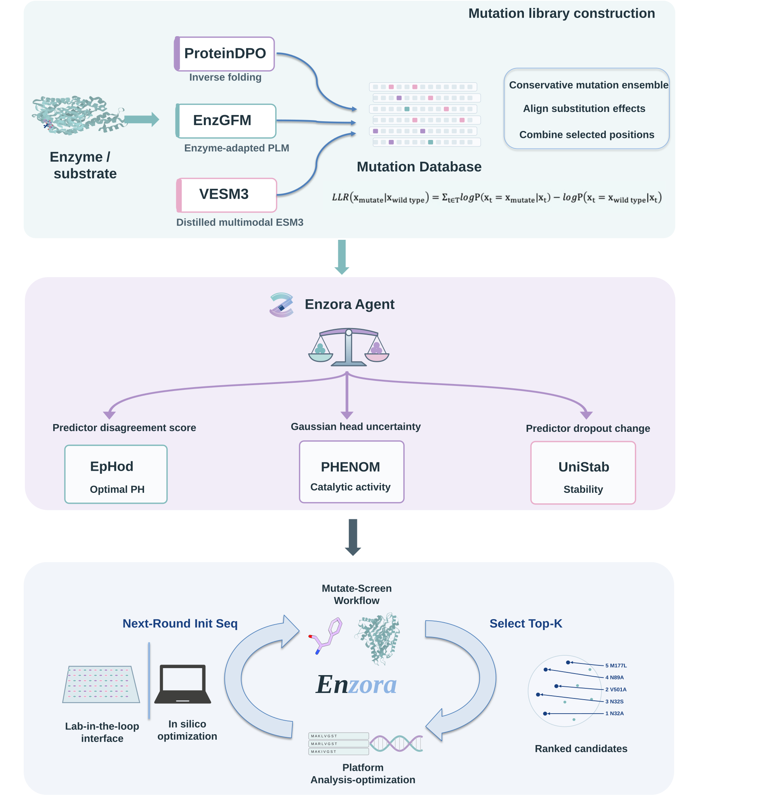

# Enzora



**Automated mutation, screening and optimization for enzyme engineering.**

[Open the workspace](https://enzora-agent.com/) · [Explore the demo](https://enzora-agent.com/?demo=1#/workbench) · [Phenom model](https://github.com/YuzhangLi2281/Phenom)

Enzora connects a three-model mutation library to multi-objective screening and experimental preparation. Researchers supply an enzyme sequence, a substrate and design goals. The workspace returns ranked protein candidates, inspectable prediction evidence and optional host-specific coding sequences.

## Workflow

1. **Construct a library.** ProteinDPO, EnzGFM and VESM3 provide complementary sequence and structural priors. VESM aligns and calibrates their substitution log-likelihood ratios. Mutation quota, order and allowed positions are editable; the default is 1,000 single substitutions.
2. **Screen and balance.** Phenom predicts enzyme–substrate kinetics, EpHod predicts optimum pH, and UniStab predicts stability changes. MiniMax reads their prediction evidence and proposes confidence controls. User preferences remain explicit and editable.
3. **Inspect and export.** Explore the sequence UMAP, compare Top-K candidates with WT, inspect every substitution and export the report or sequence records. Optional codon optimization generates synonymous DNA for the selected expression host.

Desktop wheel gestures move between three full-screen stages with eased acceleration and deceleration. Scrolling and stage navigation change the view. **Start Screening** starts prediction after library construction; **Select Top-K & generate report** starts final selection and reporting after scoring. These actions are explicit computational boundaries.

The live workspace requires a workspace access code. Demo mode runs in the browser with labelled simulated results.

## Enzora Assistant and tools

Enzora Assistant uses MiniMax native function calls. Its icon row provides direct guidance to **ESM Atlas**, **Structure**, **Trim region** and **Codons**. The dialog can be dragged and resized.

- **ESM Atlas:** retrieve a stored record by UniProt accession, Atlas hash or exact protein sequence. Inspect sequence metadata, SAE features, source links and available predicted structures. Optional similarity search uses SAE feature cosine similarity. Lookup does not trigger folding.
- **Structure:** rotate and zoom the supplied WT backbone or an available Atlas structure in the molecular viewer. New ESMFold2 predictions require an administrator-provided Biohub token.
- **Trim region:** extract an explicitly specified, inclusive, 1-based residue interval. The result is a separate sequence for inspection and export.
- **Codons:** generate host-specific CDS from protein sequences. Eleven built-in host tables work offline, including *Bacillus subtilis* and *Escherichia coli*. Other hosts can use an explicitly requested online codon table.
- **Score balance:** inspect scorer evidence and apply validated preferences and confidence controls during screening.

The **Model&Tools** page calls the same execution functions through explicit input forms. It supports database lookup, sequence translation, region extraction, structure inspection and codon optimization. Rosetta is not part of the deployed tool catalogue.

## Scoring across design rounds

The default policy scores signed changes relative to a WT reference:

```text
gain_activity  = candidate_log10_kcat − WT_log10_kcat
gain_pH        = |WT_pH − target_pH| − |candidate_pH − target_pH|
gain_stability = −predicted_ddG

raw_i          = sigmoid(gain_i / scale_i)
reliability_i  = 1 / (1 + uncertainty_i / uncertainty_scale_i)
component_i    = 0.5 + reliability_i × (raw_i − 0.5)
weight_i       = preference_i × confidence_i / Σ(preference × confidence)
final_score    = Σ(weight_i × component_i)
```

The first scoring pool determines empirical scales, subject to explicit native-unit resolution floors. `scoring_reference.json` freezes these scales, uncertainty scales and WT predictions. Reuse that reference and policy when comparing subsequent rounds. A WT-equivalent prediction is neutral at 0.5; adding an extreme candidate does not rescale existing candidates.

Phenom supplies native Gaussian-head sigma. EpHod supplies submodel disagreement; UniStab supplies regression-head MC-dropout variation. These quantities inform ranking and balancing; they are not interchangeable calibrated probabilities. MiniMax decisions and accepted manual changes are recorded separately from predictions.

The website executes one three-stage run at a time. Cross-round studies reuse exported candidates and a frozen reference policy.

## Repository layout

```text
config/                         YAML model paths, requests and runtime settings
resource/                       SVG artwork, fonts and attribution
src/Enzora_Agent/               Workflow, scoring, tools and outputs
src/Enzora_Mutation/            VESM library construction
src/Enzora_Screening/           Phenom, EpHod and UniStab adapters/code
src/Enzora_Software_Webs/web/    React workspace
src/Enzora_Software_Webs/utils/  FastAPI service and plugins
```

Model weights are configured separately and are not included in this repository. The Phenom repository distributes its own released checkpoint. Obtain other model assets from their original projects under their respective terms.

## Run locally

Use Python 3.10 or newer for the API and Node.js 20 or newer for the frontend. Scientific models use separately configured Python environments.

```bash
git clone https://github.com/YuzhangLi2281/Enzora.git
cd Enzora
python3 -m venv .venv
source .venv/bin/activate
pip install -r src/Enzora_Software_Webs/utils/server/requirements.txt
npm --prefix src/Enzora_Software_Webs/web ci
```

Edit `config/server.yaml` and `config/mutation.yaml` with model repositories, interpreters and weight paths. Phenom preprocessing requires the matching ESMC implementation and MolT5 assets. UniStab requires its matching fair-esm/OpenFold dependencies. VESM3 loads its ESM3 base before applying the fine-tuned layers.

Set `llm.enabled: true` for MiniMax. Provide `MINIMAX_API_KEY` through the process environment or the server's private `.env`. The configured China endpoint is `https://api.minimax.cn/v1`; the model is `MiniMax-M2.5`. Keep provider credentials on the backend. `ENZORA_ACCESS_TOKEN` controls workspace access. `BIOHUB_API_TOKEN` enables the optional folding tool.

```bash
python src/Enzora_Software_Webs/utils/server/run.py --host 127.0.0.1 --port 8000
```

In a second terminal:

```bash
VITE_PROXY_TARGET=http://127.0.0.1:8000 npm --prefix src/Enzora_Software_Webs/web run dev
```

Open the address printed by Vite. Add `?demo=1#/workbench` for the offline demonstration. For a static deployment, set the public API URL in `web/public/config.js` before building:

```bash
npm --prefix src/Enzora_Software_Webs/web test
npm --prefix src/Enzora_Software_Webs/web run build
```

For the CLI, replace the example protein and configure paths in `config/request.example.yaml`:

```bash
PYTHONPATH=src python -m Enzora_Agent.cli check-paths config/request.example.yaml
PYTHONPATH=src python -m Enzora_Agent.cli run config/request.example.yaml
```

## Formats and API

`BioArtifact` carries sequence records, predictions and annotations between tools. Its JSON schema identifier is `enzora.bioartifact/1`.

| Format | Import and export |
| --- | --- |
| FASTA | Protein/DNA/RNA sequences; annotations beyond headers are omitted |
| CSV | Explicit `id,name,type,sequence` records with supported annotations |
| JSON | Complete Enzora BioArtifact records |
| GenBank | Sequence records with Enzora annotations |
| SBOL | Explicit sequence records; assembly/circuit semantics are outside this adapter |

The results page exports Top-K sequences in these five formats. CSV/JSON carry prediction evidence; mutation comparisons highlight every changed residue in deep blue. Reports, PDB structures and optimized CDS have separate download actions.

| Endpoint | Purpose |
| --- | --- |
| `POST /api/runs` | Submit a library request |
| `POST /api/runs/{id}/advance` | Explicitly start phase 2 or 3 |
| `POST /api/runs/{id}/balance` | Apply validated preferences and confidence controls |
| `POST /api/chat/stream` | Assistant tool use with connection keepalive |
| `POST /api/tools/atlas` | Retrieve an Atlas record or feature-similar proteins |
| `POST /api/tools/sequence` | Execute an explicit sequence/structure operation |
| `POST /api/input/export` | Serialize a BioArtifact |

Authenticated clients send the workspace token in the `Authorization: Bearer` header.

## Runtime management

The server supports local subprocesses or administrator-configured Slurm jobs. CPU API service and GPU inference allocations remain separate. API restarts attach to persisted scheduler IDs instead of submitting duplicate model jobs.

Keep releases, private configuration, shared model assets and per-run outputs in separate directories. Each run retains its request, predictions, accepted policy, tool audit, report and diagnostics. With `runtime.keep_temp: false`, task-specific graphs, raw logits and temporary tensors are removed after completion, failure or confirmed cancellation. Shared weights and active-run caches are retained.

## References and acknowledgments

Enzora combines the following projects. Their source, weights and licences remain governed by the original authors.

- [VESM](https://github.com/ntranoslab/vesm): variant-effect modelling and VESM3.
- [ProteinDPO](https://github.com/evo-design/protein-dpo): preference-aligned inverse folding; [ESM-IF1 / fair-esm](https://github.com/facebookresearch/esm).
- [EnzGFM](https://github.com/DeepBxM/EnzGFM): enzyme-domain protein modelling.
- [PHENOM](https://github.com/YuzhangLi2281/Phenom): enzyme–substrate kinetic prediction with Gaussian uncertainty heads.
- [PSICHIC](https://github.com/huankoh/PSICHIC): hierarchical protein–ligand interaction modelling; upstream code uses Apache-2.0.
- [EpHod](https://github.com/beckham-lab/EpHod): optimum-pH prediction.
- [UniStab](https://github.com/xlab-BioAI/UniStab): protein stability prediction.
- [MolT5](https://github.com/blender-nlp/MolT5): molecular language representations.
- [MiniMax](https://platform.minimax.io/docs/api-reference/text-openai-api): language-model API and native function calls.
- [ESM Atlas](https://www.biohub.ai/esm/protein/atlas/api-docs/): protein records, structures and SAE feature search.
- [UMAP](https://github.com/lmcinnes/umap), [Plotly](https://github.com/plotly/plotly.js) and [NGL](https://github.com/nglviewer/ngl): sequence and molecular visualization.
- [Kazusa Codon Usage Database](https://www.kazusa.or.jp/codon/): host-specific codon usage.

We thank [IDDLab](https://github.com/Intelligent-Drug-Discovery-Lab) and [Theta Team](https://www.thetateam.net/) for scientific guidance and project support.

## License

Original Enzora code is released under the [MIT License](LICENSE). Third-party components retain their own licences and notices. Refer to each upstream project before redistributing code or weights.
